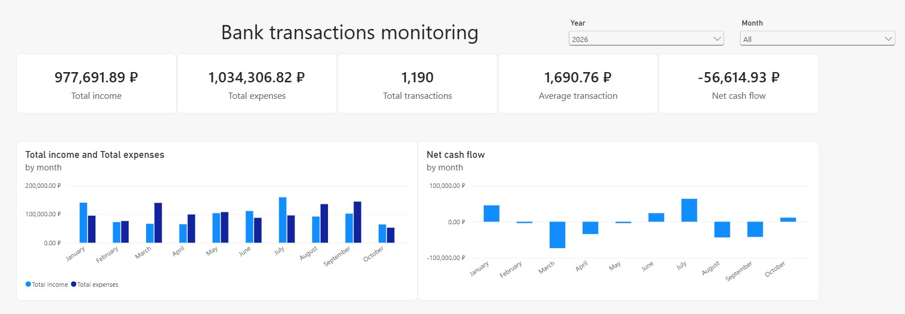

# Bank Transactions Monitoring



## Project Overview

**Bank Transactions Monitoring** is a personal data analytics project designed to process, store, and analyze personal bank transactions.

The project implements an end-to-end ETL pipeline that extracts transaction data from a Sberbank PDF statement, transforms it into a structured format, loads it into DuckDB, and exports the resulting dataset to Parquet for further analysis in Power BI.

An interactive Power BI dashboard provides insights into income, expenses, and net cash flow.

A synthetic transaction dataset is included for demonstration purposes, allowing users to explore the dashboard without exposing real personal banking information.

## Implemented Features

### 1. Sberbank Statement Parser

- Extracts transaction data from a Sberbank PDF bank statement.
- Supports a specific Sberbank statement format.
- Processes transactions for the statement period selected by the user in the Sberbank application.
- Converts extracted data into a structured CSV file.

### 2. DuckDB Data Loader

- Loads transaction data from CSV into DuckDB.
- Uses SQL scripts for table creation, data truncation, and insertion.
- Implements a full refresh loading strategy.
- Uses database transactions to ensure atomicity.
- Validates the number of loaded records before committing changes.
- Rolls back the transaction if an error occurs or the input dataset is empty, preserving the previously loaded data.

### 3. Parquet Export

- Exports the processed transaction dataset from DuckDB to Parquet.
- Uses an efficient columnar storage format for analytical workloads.
- Provides a data source for Power BI.

### 4. Power BI Dashboard

- Provides an interactive dashboard for monitoring personal finances.
- Displays key financial metrics, including income, expenses, and net cash flow.
- Supports filtering by year and month.
- Visualizes monthly income and expenses.
- Uses a configurable project directory parameter in Power Query to simplify relocation between machines.

### 5. Synthetic Sample Dataset

- Includes a synthetic dataset with the same schema as the parser output.
- Contains fictional transaction descriptions, operation codes, amounts, and account balances.
- Is intended exclusively for dashboard demonstration and testing.
- Does not contain real personal banking information.

## Data Flow

```text
Sberbank PDF Statement
        |
        v
Bank Statement Parser
        |
        v
       CSV
        |
        v
DuckDB Data Loader
        |
        v
      DuckDB
        |
        v
   Parquet Export
        |
        v
      Parquet
        |
        v
Power BI Dashboard
```

The synthetic dataset can also be used as an alternative input for demonstrating the dashboard without processing a real bank statement.

## Tech Stack

| Technology | Purpose |
|---|---|
| Python | ETL development |
| PyMuPDF | PDF text extraction |
| Pandas | Data processing and CSV generation |
| DuckDB | Analytical database |
| SQL | Database operations and data loading |
| Parquet | Columnar data storage and data exchange |
| Power Query (M) | Data source configuration and transformation |
| Power BI | Data modeling and dashboard development |
| Git | Version control |

## Project Structure

```text
bank_transactions_monitoring/
├── data/
│   └── sample/
│       └── synthetic_bank_transactions.csv
├── power_bi/
│   └── bank_transactions_dashboard.pbix
├── sql/
│   ├── create_bank_transactions.sql
│   ├── truncate_bank_transactions.sql
│   ├── insert_into_bank_transactions.sql
│   ├── truncate_bank_transactions.sql
│   └── count_bank_transactions_table_rows.sql
├── src/
│   ├── parse_bank_statement.py
│   └── load_to_duckdb.py
├── tests/
├── .gitignore
└── README.md
```

The following files are generated locally by `load_to_duckdb.py` and are not included in the repository:

```text
data/
├── bank_transactions.duckdb
└── bank_transactions.parquet
```

## Data Schema

The `bank_transactions` table contains the following fields:

| Column | Data Type | Description |
|---|---|---|
| `operation_date` | DATE | Transaction date |
| `processing_datetime` | TIMESTAMP | Transaction processing date and time |
| `operation_code` | VARCHAR | Bank operation code |
| `operation_description` | VARCHAR | Transaction description |
| `operation_amount` | DECIMAL(38, 2) | Transaction amount |
| `balance_after_operation` | DECIMAL(38, 2) | Account balance after the transaction |

## Loading Strategy

The current implementation uses a **full refresh** approach.

Each loading run performs the following steps:

1. Starts a database transaction.
2. Truncates the existing `bank_transactions` table.
3. Loads transactions from the input CSV file.
4. Checks the number of records in the target table.
5. Exports the resulting dataset to Parquet.
6. Commits the transaction if loading and validation complete successfully.
7. Rolls back the transaction if an error occurs or the input dataset is empty.

This approach ensures that previously loaded database data is preserved if the new dataset cannot be loaded successfully.

## Getting Started

### Prerequisites

- Python 3.11+
- Required Python dependencies
- Power BI Desktop (for opening and refreshing the dashboard)

### 1. Clone the Repository

```bash
git clone https://github.com/Waredor/bank_transactions_monitoring.git
cd bank_transactions_monitoring
```

### 2. Prepare the Input Dataset

There are two ways to prepare the input CSV file.

**Option A: Use your own bank statement**

1. Export a Sberbank PDF statement for the required period.
2. Run the statement parser.
3. Use the generated CSV as input for the DuckDB loader.

**Option B: Use the synthetic sample dataset**

Use the provided file:

```text
data/sample/synthetic_bank_transactions.csv
```

This dataset is intended for demonstration and does not contain real financial information.

### 3. Run the ETL Pipeline

Run the existing ETL scripts to process the input dataset and generate the analytical database and Parquet file.

The exact input file path must match the configuration expected by `load_to_duckdb.py`.

After successful execution, the following files will be generated in the `data/` directory:

```text
data/
├── bank_transactions.duckdb
└── bank_transactions.parquet
```

These files are generated locally and are not tracked in Git.

### 4. Configure the Power BI Data Source

The Power BI report uses the generated Parquet file as its data source.

The root project directory is configured through a Power Query parameter named `ProjectPath`.

When opening the report on another machine:

1. Open the PBIX file in Power BI Desktop.
2. Open Power Query Editor.
3. Navigate to **Manage Parameters**.
4. Update `ProjectPath` to point to the local project directory.
5. Apply the changes and refresh the report.

The Parquet file must be generated before refreshing the report.

## Demo Dataset

The repository includes a synthetic dataset located in `data/sample/`.

It allows users to reproduce the dashboard without providing their own bank statements.

**Important:** All records in the sample dataset are fictional and must not be interpreted as actual financial activity.

## Roadmap

- [ ] Implement transaction categorization based on operation descriptions.
- [ ] Add automated ETL tests using `pytest`.
- [ ] Develop additional analytical data models and extend dashboard capabilities.
- [ ] Improve the data loading pipeline and consider incremental loading.
- [ ] Expand support for additional bank statement formats.

## Current Limitations

- The parser currently supports only one specific Sberbank PDF statement format.
- The statement period must be selected manually by the user.
- Transaction categorization has not yet been implemented.
- The data loader uses full refresh rather than incremental loading.
- Automated ETL tests have not yet been implemented.
- The Power BI report requires a locally generated Parquet file and a correctly configured `ProjectPath` parameter.

## Project Status

**ETL pipeline and initial Power BI dashboard implemented.**

The project currently supports extracting transactions from a Sberbank PDF statement, transforming and loading the data into DuckDB, exporting the resulting dataset to Parquet, and analyzing financial activity through an interactive Power BI dashboard.

A synthetic dataset is included for demonstration purposes.